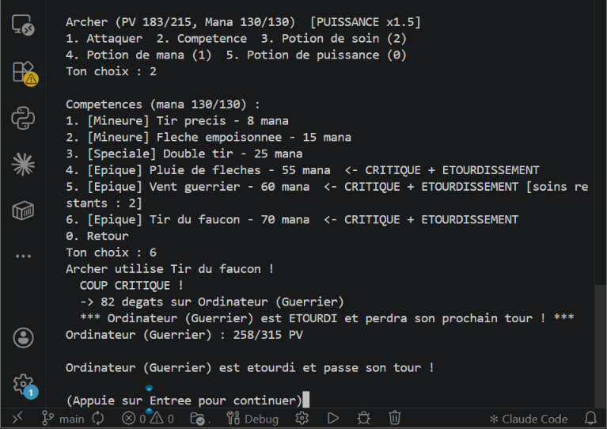

# Arena Brawl

Jeu de combat au tour par tour en console, écrit en C++17.
Deux combattants s'affrontent dans une arène jusqu'à ce que l'un tombe à 0 point de vie.



## Fonctionnalités

- 3 classes : Guerrier, Mage et Archer, chacune avec ses compétences
- 2 modes de jeu : 1 VS 1 (même clavier) et 1 VS Ordinateur (3 niveaux de difficulté)
- Armes, équipements de classe et accessoires qui donnent des bonus
- Système de mana et compétences mineures, spéciales et épiques
- Potions de soin, de mana et de puissance
- Coups critiques, étourdissement et butin de potions
- Objets épiques à débloquer en plein combat

## Compiler et lancer

Prérequis : un compilateur C++17 (g++).

**Windows (PowerShell)**
```
g++ -std=c++17 -Wall -Wextra -Iinclude (Get-ChildItem src\*.cpp) -o arena-brawl
.\arena-brawl
```

**Linux / macOS**
```
g++ -std=c++17 -Wall -Wextra -Iinclude src/*.cpp -o arena-brawl
./arena-brawl
```
**Avec CMake (optionnel)**
```
cmake -S . -B build
cmake --build build
```
L'exécutable se trouve ensuite dans le dossier `build`. Sous Windows avec MinGW, ajoute `-G "MinGW Makefiles"` à la première commande.

## Règles du jeu

### Les classes

| Classe | PV | Mana | Puissance | Particularité |
|---|---|---|---|---|
| Guerrier | 250 | 70 | 12 | encaisse 30 % de dégâts en moins |
| Archer | 200 | 120 | 10 | 20 % de chances de critique |
| Mage | 180 | 250 | 8 | énormément de mana, mais fragile |

Chaque classe possède 2 compétences mineures, 1 spéciale et 3 épiques.

### Les dégâts

> Dégâts = Puissance × Coefficient du rang × variance (±15 %), puis ×1,5 en cas de critique

| Type d'action | Coefficient |
|---|---|
| Attaque normale | 100 % |
| Compétence mineure | 130 % |
| Compétence spéciale | 200 % |
| Compétence épique | 300 % |

Une compétence qui soigne inflige 50 % de dégâts en moins, une compétence à coup double 30 % en moins.

### Le mana

Chaque compétence consomme du mana : plus elle est puissante, plus elle coûte. Le mana se régénère de 10 % du maximum à chaque tour. Les compétences de soin ne peuvent être utilisées que 2 fois par combat.

### Les potions

| Potion | Quantité | Effet |
|---|---|---|
| Soin | 2 | rend 30 % des PV max (consomme le tour) |
| Mana | 2 | rend 40 % du mana max (consomme le tour) |
| Puissance | 1 | puissance ×1,5 jusqu'à la fin du tour, coûte 15 % des PV max, action gratuite |

Aucune récupération automatique de PV : on ne se soigne qu'avec les potions et les compétences de soin.

### Critiques et combo

- Toute attaque a 10 % de chances d'être critique (20 % pour l'Archer) : dégâts ×1,5.
- **Combo** : une compétence épique lancée sous l'effet de la potion de puissance est un critique garanti. L'adversaire est **étourdi** (il saute son prochain tour) et peut laisser tomber une potion (60 % de chances) que l'attaquant récupère automatiquement.

### L'équipement

Chaque combattant porte une arme, un équipement de classe et un accessoire. Au départ, il ne peut équiper qu'**un seul objet épique**. L'autre se débloque en combat quand sa condition est remplie.

| Classe | Objet épique | Condition de déblocage |
|---|---|---|
| Guerrier | Lame du Titan | encaisser 150 dégâts au total |
| Guerrier | Armure du Colosse | tomber à 40 % de PV ou moins |
| Mage | Sceptre des Etoiles | lancer 3 compétences épiques |
| Mage | Couronne du Neant | infliger 200 dégâts au total |
| Archer | Arc du Faucon | réussir 2 coups doubles |
| Archer | Cape de l'Aigle | tomber à 30 % de PV ou moins |

### L'ordinateur

| Niveau | Comportement |
|---|---|
| Faible | attaques normales et compétences mineures, soins si PV bas, 2 chances sur 10 de tenter le combo |
| Normal | ajoute les compétences spéciales et quelques épiques, 7 chances sur 10 de tenter le combo |
| Extrême | coup de grâce, combo dès que possible, mana gardé en réserve, PV maintenus hauts, équipement optimisé |

## Structure du projet

```
arena-brawl/
├── include/        en-têtes (.hpp)
│   ├── AI.hpp
│   ├── Archer.hpp
│   ├── Competence.hpp
│   ├── Equipement.hpp
│   ├── Fighter.hpp
│   ├── Game.hpp
│   ├── Mage.hpp
│   ├── Utils.hpp
│   └── Warrior.hpp
├── src/            sources (.cpp)
│   ├── AI.cpp
│   ├── Competence.cpp
│   ├── Equipement.cpp
│   ├── Game.cpp
│   ├── Utils.cpp
│   └── main.cpp
├── docs/
│   └── combat.png
└── README.md
```

## Auteur

[mekemdjeff08](https://github.com/mekemdjeff08-prog)